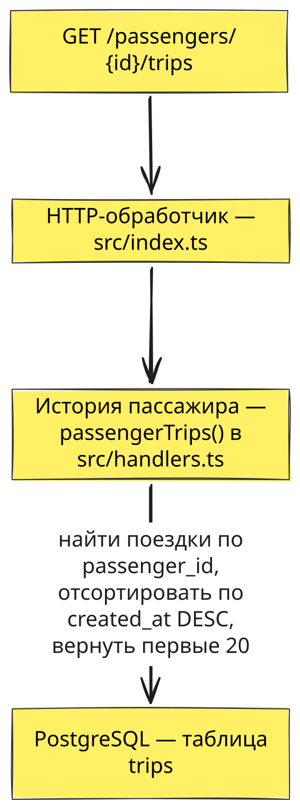

## Граница системы

Назначение сервиса - связать клиента, которому нужно добраться из точки А в точку Б
и водителя (исполнителя) который готов оказать услугу перевозки.
Сервис, рассчитывает тарифы, принимает заказ, подбирает водителя исходя из расположения клиента и водителя.
При подборе предлагается максимально близкий к клиенту доступный водитель.

Внешние участники:
Клиент - создает заказ.
Водитель - принимает заказ.
Сервис уведомлений - систему, используемая для информирования.

В границу системы входит: база данных, 2 экземпляра приложения и nginx.

## Требования

Посчитайте среднюю и пиковую частоту создания поездки, чтения состояния и просмотра истории. Запишите цель p95 истории и объём поездок за год.

## Операции

| Поток            | Исходные данные                                                               | Средняя частота                                     | Пиковая частота                                             |
| ---------------- | ----------------------------------------------------------------------------- | --------------------------------------------------- | ----------------------------------------------------------- |
| Создание поездки | 200 000 поездок/сутки                                                         | 200 000 / 86 400 ≈ 2,3 поездки/с                    | (200 000 / 86 400) × 4 ≈ 9,3 поездки/с                      |
| Чтение состояния | 1 запрос каждые 5 секунд в течение 15-минутной поездки; 200 000 поездок/сутки | (15 × 60 / 5) × 200 000 / 86 400 ≈ 416,7 запросов/с | ((15 × 60 / 5) × 200 000 / 86 400) × 4 ≈ 1 666,7 запросов/с |
| Просмотр истории | 60 000 открытий/сутки                                                         | 60 000 / 86 400 ≈ 0,7 запроса/с                     | (60 000 / 86 400) × 2 ≈ 1,4 запроса/с                       |

Объём поездок за год - 200 000 \* 365 = 73 000 000 поездок/год.

## Окружение

## Компоненты

## Модель данных

У одного пассажира может быть много поездок, trips.passenger_id ссылается на passengers.id

История фильтруется по полю passenger_id и сортируется по полю created_at (DESC). Так как пользователю нужно получить список последних поездок.

Критический путь истории от HTTP-запроса до ответа:

1. Пассажир
2. Nginx
3. HTTP-маршрут passengers/${id}/trips вызывает passengerTrips()
4. PostgreSQL: sql запрос выбирает 20 строк, фильтруя по passenger_id и сортирует.
5. JSON-ответ

## Итог

Свяжите требование, базовый результат, решение и повторный результат. Назовите границу вывода и следующий опыт.
