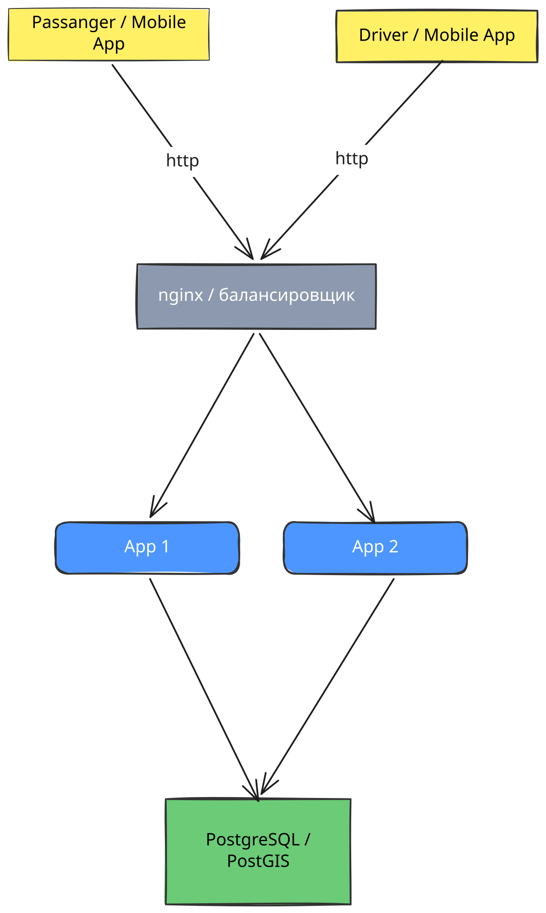

## Граница системы

Назначение сервиса — связать клиента, которому нужно добраться из точки А в точку Б,
и водителя, который готов выполнить поездку.
Сервис рассчитывает тарифы, принимает заказ и подбирает водителя с учётом местоположения клиента и водителя.
Клиенту предлагается ближайший доступный водитель.

Внешние участники:
Клиент — создаёт заказ.
Водитель — принимает заказ.
Сервис уведомлений — внешняя система для информирования участников.

В границу системы входят база данных, два экземпляра приложения и Nginx.

## Требования

Посчитайте среднюю и пиковую частоту создания поездки, чтения состояния и просмотра истории. Запишите цель p95 истории и объём поездок за год.

## Операции

| Поток            | Исходные данные                                                               | Средняя частота                                     | Пиковая частота                                             |
| ---------------- | ----------------------------------------------------------------------------- | --------------------------------------------------- | ----------------------------------------------------------- |
| Создание поездки | 200 000 поездок/сутки                                                         | 200 000 / 86 400 ≈ 2,3 поездки/с                    | (200 000 / 86 400) × 4 ≈ 9,3 поездки/с                      |
| Чтение состояния | 1 запрос каждые 5 секунд в течение 15-минутной поездки; 200 000 поездок/сутки | (15 × 60 / 5) × 200 000 / 86 400 ≈ 416,7 запросов/с | ((15 × 60 / 5) × 200 000 / 86 400) × 4 ≈ 1 666,7 запросов/с |
| Просмотр истории | 60 000 открытий/сутки                                                         | 60 000 / 86 400 ≈ 0,7 запроса/с                     | (60 000 / 86 400) × 2 ≈ 1,4 запроса/с                       |

Объём поездок за год — 200 000 × 365 = 73 000 000 поездок/год.

## Окружение

## Компоненты

## Модель данных

У одного пассажира может быть много поездок. Поле `trips.passenger_id` ссылается на `passengers.id`.

История фильтруется по полю `passenger_id` и сортируется по `created_at DESC`, чтобы последние поездки отображались первыми.

Критический путь истории от HTTP-запроса до ответа:

1. Пассажир отправляет запрос.
2. Nginx передаёт его приложению.
3. HTTP-маршрут `/passengers/${id}/trips` вызывает `passengerTrips()`.
4. PostgreSQL выполняет SQL-запрос: выбирает 20 поездок пассажира по `passenger_id` в порядке `created_at DESC`.
5. Приложение возвращает JSON-ответ.

## Итог

| Требование          | Базовый результат                                           | Решение                                               | Повторный результат                                           |
| ------------------- | ----------------------------------------------------------- | ----------------------------------------------------- | ------------------------------------------------------------- |
| p95 истории ≤ 50 мс | 56,4 мс, `Parallel Seq Scan` просматривал около 2 млн строк | Составной индекс по `passenger_id`, `created_at DESC` | 1,29 мс, `Index Scan` выдал 20 строк без отдельной сортировки |

Подробности решения — в [ADR](./design/adr/010-history-index.md). Замеры и планы запроса — в отчётах [baseline](./reports/baseline.md) и [after-index](./reports/after-index.md). В обоих прогонах доля ошибок — 0%, `dropped_iterations` — 0.

Граница вывода:

- Учебный набор: 2 000 000 поездок после `make seed-large`. Во время нагрузки создаются дополнительные поездки.
- Локальный стенд: Nginx, два экземпляра приложения и PostgreSQL. Лимит каждого экземпляра приложения — 0,5 CPU и 512 МБ памяти.
- Один и тот же профиль: создание поездки — 9 запросов/с, чтение состояния — 1 666 запросов/с, просмотр истории — 1,4 запроса/с. Прогрев — 10 с, замер — 30 с.

В этих условиях индекс ускорил чтение истории. Из этого опыта нельзя сделать вывод, какой будет предел при городском объёме данных и другой нагрузке.

Следующий ожидаемый предел — чтение состояния поездки: в повторном прогоне было 50 029 таких запросов против 42 запросов истории. Пока это гипотеза: при текущей частоте нет пропущенных итераций и ошибок.

Следующий опыт: выяснить, выдержит ли стенд больше запросов на чтение состояния. Изменить только `readRate` с 1 666 до 2 000 запросов/с, остальные условия оставить теми же. Опыт пройден, если `dropped_iterations` = 0, доля ошибок ≤ 1%, а p95 истории ≤ 50 мс.
